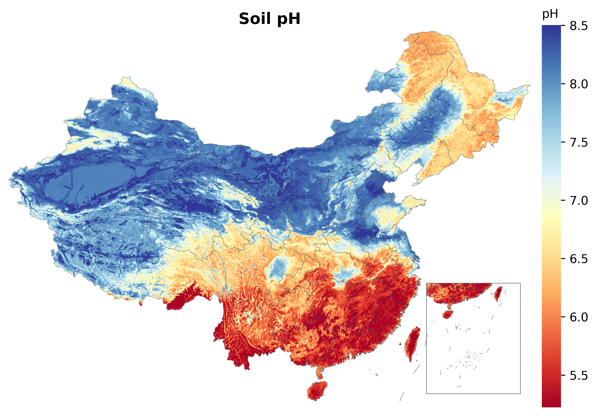
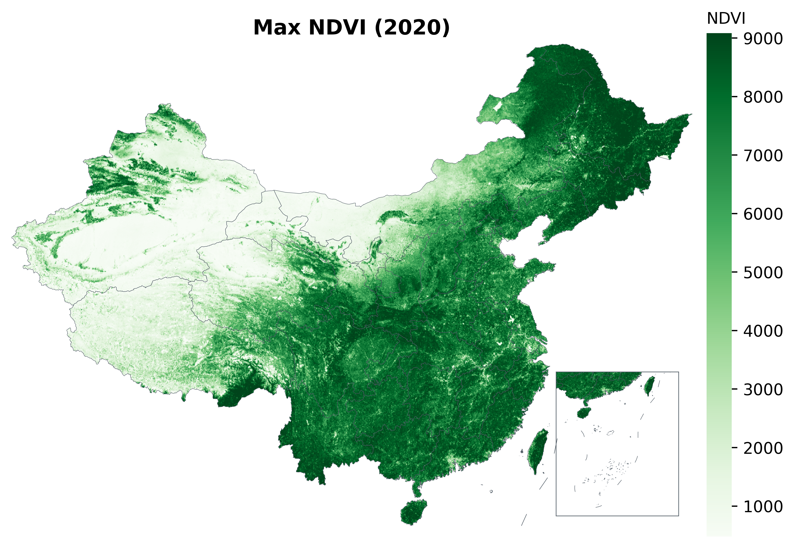
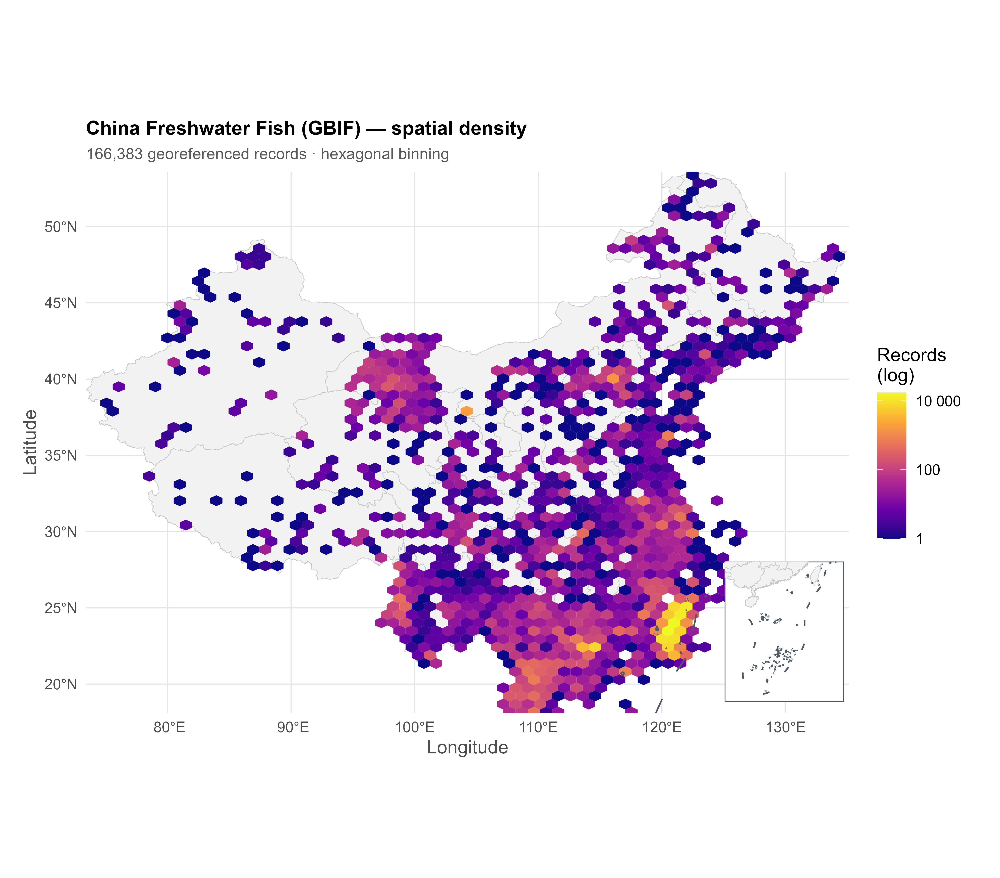
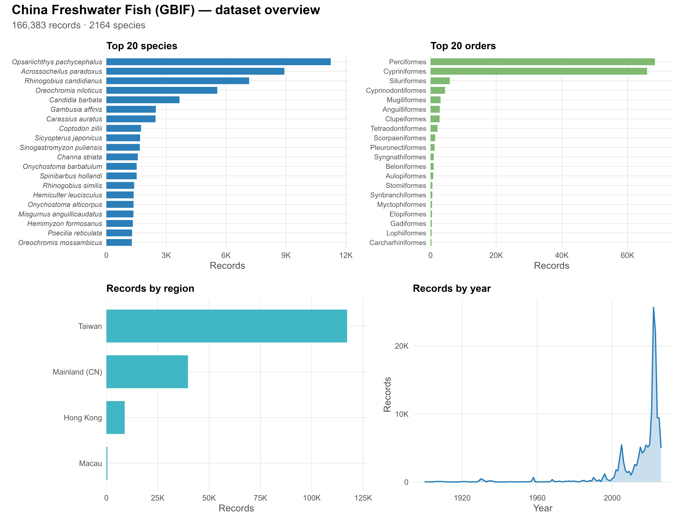

<div align="center">

# Very

**个人 Skill 仓库 · Personal Skills Collection**

_可复用、可组合、开箱即用的 Agent 技能集合_

<br/>

[](#-技能目录)
[](#)
[](#)
[](#-许可)
[](#-路线图)

</div>

---

## 📌 关于本仓库

**Very** 是我的个人 **Skill（技能）仓库**，用来沉淀那些经过打磨、可以反复调用的工作流与工具。

每个技能都遵循统一约定：一个自包含的目录，带 `SKILL.md` 说明、可执行脚本、内置资源与测试，
**克隆即用、无需额外配置**。目前以科研数据可视化与学术汇报产出为主，未来会逐步纳入更多方向的技能与工具。

> 定位：个人技能资产库 —— 让好用的东西可复用、可分享、可持续演进。

---

## 🧩 技能目录

| 技能 | 说明 | 引擎 | 状态 |
|------|------|------|------|
| [**geo-viz**](skills/geo-viz) | 把栅格数据（GeoTIFF）渲染成出版级中国地图，自动带南海九段线 + 小地图、Nature 级配色、600dpi 透明 PNG + 矢量 PDF | Python / R | ✅ 稳定 |
| [**gbif-occ**](skills/gbif-occ) | 从 GBIF 大规模下载物种出现记录：把任意类群（含「鱼类」这类非单一节点的并系群）解析为完整 taxonKey、核查分类学全覆盖、异步全量下载并留存 DOI，出数据展示/分析图，附中国四地淡水鱼一键预设 | R | ✅ 稳定 |
| [**minimal-scientific-slides**](skills/minimal-scientific-slides) | 学术汇报 PPT 的**内容 + 版式 + 复核**体系：论证先行式标题（ghost deck test）、白底黑字、中文黑体 / 西文 Arial、图占 75% 版面、面板字母 + 规范来源行、中英双语讲稿备注，附自动化断言与四轮目视复核清单 | 文档规范 | ✅ 稳定 |

<sub>更多技能开发中，见 [路线图](#-路线图)。</sub>

---

## ⭐ 精选：geo-viz

> 一行命令，把地理栅格数据画成规范、好看、能直接进论文的中国地图。

<div align="center">

&nbsp;&nbsp;

<br/>
<sub>使用本技能对真实环境栅格渲染的实测结果　·　左：土壤 pH（发散配色）　·　右：最大 NDVI（顺序配色），均含右下角南海小地图</sub>
</div>

<br/>

**核心能力**

- 🌏 **自动化流程** —— 重投影至 EPSG:4326、按中国边界掩膜、2–98 分位截断防离群值
- 🧩 **合规底图** —— 中国省界 + 南海九段线，右下角自动生成南海诸岛小地图
- 🎨 **多套 Nature 级配色任选** —— 顺序 / 发散 / 感知均匀三大类色盲友好主题（`blues`·`spectral`·`viridis`…），另有 20+ 按变量类型自动选色的语义键；`--reverse` 翻转、`--midpoint` 居中发散配色（异常/趋势图利器），`--list-palettes` 一览全部
- 🎯 **双引擎同色** —— 主题以显式 hex 控制点定义，Python 与 R 渲染出**完全一致**的颜色
- 📊 **连续 + 离散** —— 连续场自动渐变，分类数据自动图例（CLCD 9 类等）
- 🖨️ **出版级输出** —— 600dpi 透明 PNG + 矢量 PDF，论文 / PPT 直接用
- 🔁 **双引擎** —— Python（`rasterio/geopandas/matplotlib`）与 R（`terra/sf/ggplot2`），CLI 参数完全一致
- 📦 **数据无关** —— 传入你自己的任意 GeoTIFF 即可出图，不依赖任何私有数据集

**快速上手**

```bash
# Python
python skills/geo-viz/scripts/render_china_map.py \
    --input data.tif --output out/temp \
    --title "Annual Mean Temperature" --legend "degC" --palette temp --clamp

# R（参数一致）
Rscript skills/geo-viz/scripts/render_china_map.R \
    --input data.tif --output out/temp \
    --title "Annual Mean Temperature" --legend "degC" --palette temp --clamp
```

完整用法见 [skills/geo-viz/SKILL.md](skills/geo-viz/SKILL.md)；运行 `--list-palettes` 可查看全部配色主题。

---

## ⭐ 精选：gbif-occ

> 把「我要 *这些类群* 在 *这个地区* 的全部记录」变成一份干净、可引用、可视化的出现数据集。

<div align="center">

&nbsp;&nbsp;

<br/>
<sub>用本技能对真实下载数据（16.6 万条中国四地淡水鱼记录）的实测出图　·　左：出现点空间密度（六边形分箱，log 计数）叠合规中国底图（省界 + 南海九段线 + 南海小地图）　·　右：概览四面板（Top 物种 / 各地区 / Top 目 / 年度趋势）</sub>
</div>

<br/>

从一次真实生产任务（下载中国大陆 + 港澳台全部淡水鱼记录）沉淀而来，解决 `occ_search()` 做不到的四件事：

- 🧬 **完整类群解析** —— 许多类群**不是单一骨干节点**。「鱼类」是并系群，GBIF 把辐鳍鱼各目直接挂在 Chordata 下、无统一纲；本技能自动枚举正确的目/纲集合成 `taxonKey` 清单
- 🔍 **分类学全覆盖核查** —— 自骨干库自上而下审计：目标目/纲有无遗漏、门下有无「带现生记录却逃逸出清单」的科/属（排除化石）
- 🌐 **大规模 + 可引用** —— 走**异步 Occurrence Download API**（整库导出，非 10 万条上限），等待归档、解压、留存可引用 **DOI**
- 📊 **数据展示 / 分析可视化** —— 一步出**出现点空间密度图**（叠合规中国底图：省界 + 南海九段线 + 南海小地图） + **数据集概览四面板**（+ 可选 FishBase 栖息地构成图），600dpi PNG，通用于任意类群/地区
- 🐟 **淡水过滤（可选）** —— 用 FishBase 栖息地属性剔除纯海洋种，保守保留未知/无种名记录
- 🚀 **一键预设** —— `china_freshwater_fish` 复现整套流程；改预设即可派生你自己的类群/地区

**快速上手**

```bash
# 旗舰预设：解析鱼类 key → 覆盖核查 → 异步下载 → FishBase 淡水过滤 → 出图
Rscript skills/gbif-occ/scripts/run_preset.R --preset china_freshwater_fish --out gbif_out

# 或分步用于任意类群/地区（解析、核查、可视化均无需账号）
Rscript skills/gbif-occ/scripts/resolve_keys.R --preset fish --out keys.csv
Rscript skills/gbif-occ/scripts/download.R --keys-file keys.csv --region CN,HK,MO,TW --out gbif_out
Rscript skills/gbif-occ/scripts/visualize.R --occ gbif_out/processed/occurrences_freshwater.csv --out gbif_out/figures/fish
```

下载需免费 GBIF 账号（`.env` 提供 `GBIF_USER/GBIF_PWD/GBIF_EMAIL`，仅从环境读取、绝不落盘）。
完整用法见 [skills/gbif-occ/SKILL.md](skills/gbif-occ/SKILL.md)。

---

## ⭐ 精选：minimal-scientific-slides

> 让学术 PPT 的**论证**立在版式之前 —— 图版式规范 + 论证结构 + 复核清单三件事一起管。

不同于前两个技能，这个技能**不产出图**，它管的是「把证据讲成一场报告」。直接以学术期刊图版为基准：白底、黑字、大面积图、面板字母、规范来源行。它从两个真实科研汇报项目的多轮返工中沉淀，**每一条规则背后都是一次具体的翻车**。

<div align="center">

| 层次 | 管什么 | 关键文件 |
|---|---|---|
| **内容层** | 论证主线、行动式标题、结论句冗余、讲稿与图版一致 | `references/argument-and-titles.md` |
| **版式层** | 共享基线网格、版面家族、图 75% / 文 25%、字体与色板、来源行 | `references/style-spec.md` |
| **复核层** | 自动化断言 + 四轮目视检查（总览 / 逐页 / 跨页对比 / 距离测试） | `references/visual-review.md` |

</div>

**几条被反复验证的规则**

- 🧭 **标题即论点** —— 每页标题必须是一句完整的结论；只读标题应能讲完整场论证（ghost deck test）。`受胁物种热点与多样性热点在空间上高度重叠` 是标签，`中国淡水鱼适生区的受胁热点与多样性热点重合` 才是发现
- 🚫 **标题与结论句不得同页** —— 标题已是结论时，下方再写一句结论就是说两遍，这是学术 PPT 读起来啰嗦的头号原因
- 🖼 **图占 75% 版面** —— 图独占整页，阅读性内容移到图注与讲稿备注；「图一半文一半」视为缺陷
- 🎯 **色标方向即宽高比** —— 竖置色标约占图宽 40%，横置仅约占图高 7%；双面板地图应合成一张图、色标横置，否则并排后只占六成高度
- 🔍 **数字必须回源** —— 从图上目测的数字不算数字；类别求和要按源表重算（IUCN 受胁 = CR+EN+VU，**不含 NT**）；比率要用源值而非页面四舍五入值重算；每个 DOI 解析一次
- 🧪 **校验全绿 ≠ 做对了** —— 自动化断言之后必须逐页导出渲染图目视；讲稿与图版是否一致，只有对着图上标记才能发现

**快速上手**

```bash
# 读主说明，按 workflow 顺序执行（先定论证主线，再写标题，最后才碰版式）
cat skills/minimal-scientific-slides/SKILL.md

# 版式常数（共享基线网格 / 版面家族 / 字号色板）单独查
cat skills/minimal-scientific-slides/references/style-spec.md
```

> 该技能为**内容无关**的规范体系：它规定「怎么讲、怎么排、怎么查」，不绑定任何学科，
> 也从源 PPT 中**不复制**任何学科内容、品牌、截图或项目措辞。

---

## 🗂 仓库结构

```
Very/
├── skills/                     所有技能
│   ├── geo-viz/                中国栅格地图渲染
│   │   ├── SKILL.md            技能说明（能力 / CLI / 原理）
│   │   ├── scripts/            render_china_map.{py,R} + requirements.txt
│   │   ├── assets/china/       内置底图（省界 / 九段线，WGS-84）
│   │   ├── references/         配色键与地类定义
│   │   ├── examples/           实测示例图（真实数据渲染结果）
│   │   └── tests/              自包含冒烟测试
│   └── gbif-occ/               GBIF 物种出现记录下载
│       ├── SKILL.md            技能说明（能力 / CLI / 原理）
│       ├── scripts/            resolve_keys / verify_coverage / download / filter_habitat / visualize / run_preset / common
│       ├── assets/china/       内置合规中国底图（省界 / 九段线，WGS-84）
│       ├── presets/            旗舰预设（中国四地淡水鱼）
│       ├── references/         GBIF 知识与坑位
│       ├── examples/           真实产物（taxonKey / 引用 DOI / 出现样本 / 实测图 figures/）
│       └── tests/              自包含冒烟测试
│   └── minimal-scientific-slides/   学术汇报 PPT 的内容 + 版式 + 复核体系
│       ├── SKILL.md            主说明（workflow / 不可违背的版式规则）
│       ├── agents/             openai.yaml
│       ├── references/         argument-and-titles（论证与标题）
│       │                       style-spec（基线网格 / 版面家族 / 字体色板 / QA 清单）
│       │                       visual-review（四轮目视复核）
│       └── tests/              （暂无；规范类技能以 QA 清单代替冒烟测试）
├── .gitignore
└── README.md
```

---

## 🚀 使用方式

1. **克隆仓库**
   ```bash
   git clone https://github.com/EldonQ/Very.git
   ```
2. **进入某个技能目录**，阅读它的 `SKILL.md` —— 里面有该技能的完整用法、依赖与示例。
3. **按需安装依赖**（如 geo-viz 的 Python 依赖）：
   ```bash
   pip install -r skills/geo-viz/scripts/requirements.txt
   ```
4. **运行脚本 / 跑测试** 验证环境：
   ```bash
   python skills/geo-viz/tests/test_render.py     # RESULT: PASS
   Rscript skills/gbif-occ/tests/test_smoke.R     # RESULT: PASS
   ```

---

## 🧭 技能约定

为保持一致性，本仓库每个技能尽量满足：

- **自包含** —— 内置必要资源（底图、示例），减少外部依赖
- **有 `SKILL.md`** —— 第三人称说明「做什么 / 何时用 / 怎么用」
- **可测试** —— 提供最小可运行的冒烟测试
- **跨语言友好** —— 条件允许时提供多引擎实现，参数保持一致

---

## 🛣 路线图

- [x] `geo-viz` — 中国栅格地图渲染（Python + R）
- [x] `gbif-occ` — GBIF 物种出现记录大规模下载、分类学覆盖核查与数据可视化（R）
- [x] `minimal-scientific-slides` — 学术汇报 PPT 的论证结构、版式规范与复核体系（文档规范）
- [ ] `minimal-scientific-slides` 补 `examples/` 与 `tests/`（当前以 QA 清单代替冒烟测试）
- [ ] 更多科研可视化技能（时序、多面板拼图、专题制图模板）
- [ ] 数据处理 / 自动化工作流类技能
- [ ] 技能索引与统一调用入口

> 仓库定位会随需要演进，未来不限于科研可视化。

---

## 📄 许可

除非各技能目录另有说明，本仓库代码以 **MIT** 许可开放。内置地图矢量等第三方资源，
版权归原始提供方，请在使用前确认其许可条款。

---

<div align="center">
<sub>由 <b>@EldonQ</b> 维护 · 持续演进中 ✨</sub>
</div>
